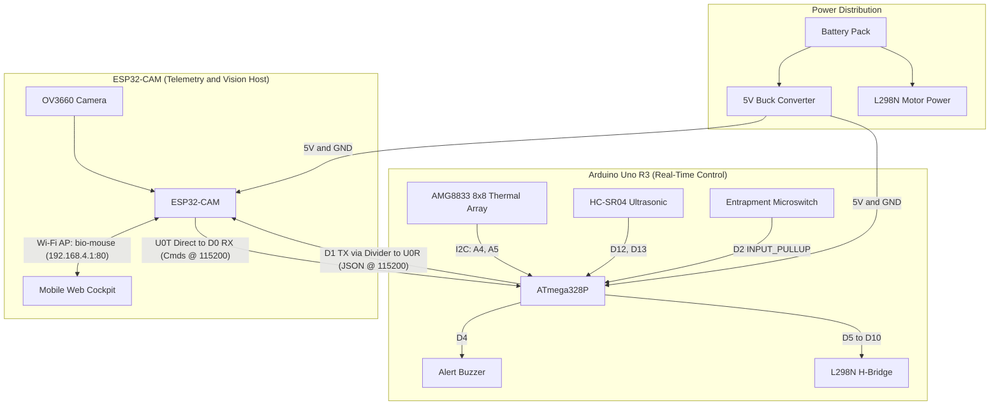

# Bio-Mouse: Dual-MCU Thermal Search-and-Rescue Robot

**Bio-Mouse** is an embedded search-and-rescue rover designed for navigating confined, low-visibility environments. It pairs an **AI-Thinker ESP32-CAM (OV3660)** with an **Arduino Uno R3** over a high-speed hardware UART bridge, combining real-time optical video, an **8×8 infrared thermal array (AMG8833)**, ultrasonic proximity guarding, and physical anti-entrapment fail-safes inside a single-port mobile web cockpit.

---

## Key Features

* **Single-Port Non-Blocking Web Cockpit (`Port 80`):** Serves live OV3660 camera frames (`/capture`), 8×8 thermal heatmaps (`/telemetry`), and low-latency D-pad motor controls (`/cmd`) simultaneously on `http://192.168.4.1` without socket lockups on browser refresh.
* **Dual Operating Modes:**
  * **Manual Mode (`M`):** Responsive touch/mouse D-pad with an automatic $12\text{ cm}$ front obstacle stop guard and manual horn alert.
  * **Autonomous Heat-Seeking Mode (`A`):** Scans 64 thermal pixels in real time, locking onto human heat signatures ($\ge 30.5\,^{\circ}\text{C}$) and steering proportionally across three spatial column zones while maintaining a $15\text{ cm}$ obstacle buffer.
* **Multi-Layered Safety Fail-Safes:**
  * **Communication Watchdog ($2.0\text{ s}$):** Automatically cuts motor power if the Wi-Fi client disconnects or UART heartbeats drop for more than 2 seconds.
  * **Anti-Entrapment Microswitch Override:** Detects physical bumper collisions, executes an immediate $400\text{ ms}$ reverse maneuver, and triggers an SOS audio alarm plus a live `ROBOT_TRAPPED` dashboard alert if pinned for $> 3\text{ seconds}$.

---

## System Architecture

---

## Hardware Bill of Materials (BOM)

| Component | Quantity | Role |
| :--- | :---: | :--- |
| **AI-Thinker ESP32-CAM (with OV3660)** | 1 | Wi-Fi Access Point, HTTP Web Server, Live Video Streamer |
| **Arduino Uno R3** | 1 | Real-time sensor polling, I2C processing, PWM motor control |
| **Panasonic AMG8833 Grid-EYE** | 1 | $8\times8$ Infrared Thermal Array Sensor (I2C) |
| **HC-SR04 Ultrasonic Sensor** | 1 | Front proximity distance measurement |
| **L298N Dual H-Bridge Motor Driver** | 1 | Drives 4WD DC gear motors |
| **Lever Microswitch** | 1 | Physical collision & anti-entrapment detection |
| **5V Piezo Buzzer** | 1 | Boot diagnostics, horn alert, and SOS entrapment alarm |
| **5V DC-DC Buck Converter (LM2596)** | 1 | Stable 5V rail for ESP32-CAM and Arduino logic |
| **$1\text{k}\Omega$ & $2\text{k}\Omega$ Resistors** | 1 set | $5\text{V} \rightarrow 3.3\text{V}$ logic level divider on Arduino TX $\rightarrow$ ESP32 `U0R` |

---

## Master Pinout & Wiring Reference

### 1. Inter-Board UART & Power Link
| Signal | Arduino Uno Pin | ESP32-CAM Pin | Notes |
| :--- | :--- | :--- | :--- |
| **Telemetry TX** | `Pin 1 (TX)` | `U0R` (GPIO 3) | Route through $1\text{k}\Omega / 2\text{k}\Omega$ voltage divider ($3.3\text{V}$ safe) |
| **Command RX** | `Pin 0 (RX)` | `U0T` (GPIO 1) | Direct jumper wire connection |
| **System Power** | `5V` | `5V` | Regulated $5.0\text{V}$ output from Buck Converter |
| **Ground** | `GND` | `GND` | Common ground shared across all boards and power supplies |

### 2. Arduino Uno R3 Peripheral Pinout
| Arduino Pin | Connected Hardware | Pin Function |
| :--- | :--- | :--- |
| **`D0 (RX)`** | ESP32-CAM `U0T` | Receives single-byte control characters (`M`, `A`, `L`, `R`, `F`, `B`, `S`, `Z`) |
| **`D1 (TX)`** | ESP32-CAM `U0R` | Streams JSON telemetry (`{"d":dist,"p":[64_pixels]}`) every $200\text{ ms}$ |
| **`D2`** | Microswitch (`COM`) | Configured as `INPUT_PULLUP`; switch `NO` terminal wired to `GND` |
| **`D4`** | Piezo Buzzer (`+`) | Audio status beeps, horn alert, and $200\text{ ms}$ pulsed SOS alarm |
| **`D5`** | L298N `ENA` | Left motor channel PWM speed (`180` / 255) |
| **`D6`** | L298N `IN1` | Left motor channel direction A |
| **`D7`** | L298N `IN2` | Left motor channel direction B |
| **`D8`** | L298N `IN3` | Right motor channel direction A |
| **`D9`** | L298N `IN4` | Right motor channel direction B |
| **`D10`** | L298N `ENB` | Right motor channel PWM speed (`180` / 255) |
| **`D12`** | HC-SR04 `TRIG` | Ultrasonic pulse trigger output |
| **`D13`** | HC-SR04 `ECHO` | Ultrasonic echo return input |
| **`A4 (SDA)`** | AMG8833 `SDA` | I2C Data line |
| **`A5 (SCL)`** | AMG8833 `SCL` | I2C Clock line |

---

## Autonomous & Safety Parameters

| Parameter | Threshold | Behavior |
| :--- | :--- | :--- |
| **Thermal Target Lock** | $\ge 30.5\,^{\circ}\text{C}$ | Ignores ambient backgrounds $< 30.5\,^{\circ}\text{C}$; tracks warmest pixel column |
| **Steering Zones (8×8 Grid)** | Cols `0–2` / `3–4` / `5–7` | Cols `0–2`: Steer Left (`F`) \| Cols `3–4`: Forward (`L`) \| Cols `5–7`: Steer Right (`B`) |
| **Auto Obstacle Stop** | $\le 15\text{ cm}$ | Halts autonomous forward tracking if an obstacle is within $15\text{ cm}$ |
| **Manual Obstacle Guard** | $\le 12\text{ cm}$ | Blocks manual forward movement (`L`) and sounds a $50\text{ ms}$ warning beep |
| **Bumper Reflex** | $t = 0\text{ ms}$ (`LOW` on `D2`) | Immediately stops, sounds buzzer, and reverses (`R`) for $400\text{ ms}$ |
| **Entrapment SOS** | Held $\ge 3000\text{ ms}$ | Locks motors in Stop (`S`), pulses buzzer, and broadcasts `{"status":"ROBOT_TRAPPED"}` |
| **Watchdog Timeout** | $2000\text{ ms}$ | Cuts motor power if no command or heartbeat arrives within $2.0\text{ seconds}$ |

---

## Flashing & Deployment Guide

1. **Disconnect UART Jumpers Before Flashing:** Unplug the wires connected to `D0`/`D1` on the Arduino and `U0R`/`U0T` on the ESP32-CAM prior to uploading code via USB/FTDI.
2. **Flash Arduino Uno:**
   * Open `firmware/arduino_uno_controller` in PlatformIO or Arduino IDE.
   * Install dependencies: `Adafruit AMG88xx Library`, `Adafruit BusIO`, and `NewPing`.
   * Upload to the Arduino Uno.
3. **Flash ESP32-CAM:**
   * Open `firmware/esp32cam_cockpit` in PlatformIO.
   * Connect `IO0` to `GND` on the ESP32-CAM and upload the firmware.
   * Disconnect `IO0` from `GND` after upload completes.
4. **Reconnect & Boot:**
   * Power both boards from the regulated $5\text{V}$ supply.
   * Reconnect the `U0R`/`U0T` UART bridge wires.
   * Listen for **1 short beep** from the Arduino (confirming AMG8833 I2C initialization; 3 beeps indicates an I2C wiring error).
   * Connect a phone or laptop to the **`bio-mouse`** Wi-Fi network (Password: `12345678`) and navigate to **`http://192.168.4.1`**.
